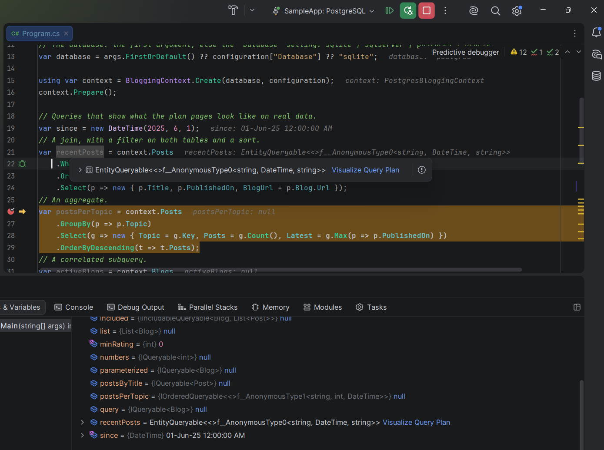
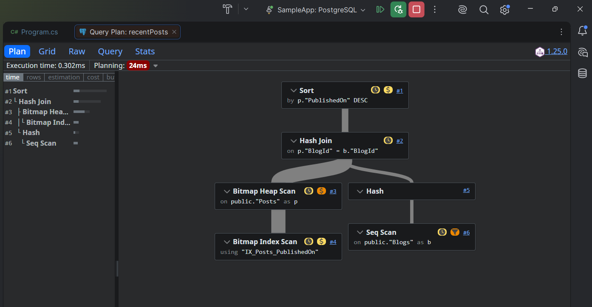
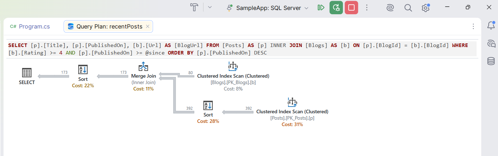
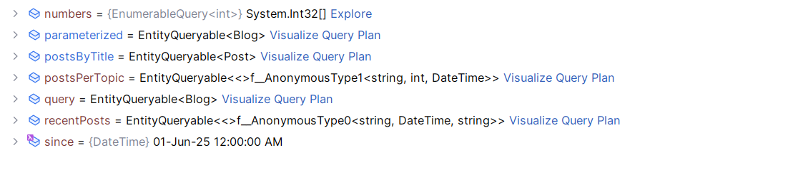

# EFCore Visualizer for Rider

View the execution plan of an Entity Framework Core query while you debug, without leaving Rider.
Supports SQL Server, PostgreSQL, Oracle and SQLite.

This is the Rider version of the [EFCore Visualizer](https://github.com/Giorgi/EFCore.Visualizer) for Visual
Studio. It shows the same plan pages.







## Requirements

* Rider 2026.2 or newer.
* An app that uses EF Core 7 or newer, on .NET 6 or newer.
* **Allow property evaluations and other implicit function calls** turned on, in **Settings | Build, Execution,
  Deployment | Debugger**. It's on by default. The plugin calls methods in your app to get the plan; with the
  setting off, it says so instead of trying.

## Installation

In Rider, open **Settings | Plugins | Marketplace**, search for **EFCore Visualizer** and install it.

To install a plugin zip instead: **Settings | Plugins**, the gear icon, **Install Plugin from Disk…**.

## Usage

1. Debug your app and pause it, for example at a breakpoint, where a query is in scope.
2. Click **Visualize Query Plan** at the end of the query's row (an `IQueryable` from EF Core, or a `DbSet`). The
   link is in **Variables**, **Watches**, the editor's hover popup and **Evaluate Expression**. You can also select the
   query and click the **Visualize Query Plan** button on the view's toolbar, or right-click it and choose
   **Visualize Query Plan**.

The plan opens in an editor tab. The menu item appears only on EF Core queries, whatever the variable's declared
type (`IQueryable`, `IOrderedQueryable`, `IEnumerable`, ...), and only in .NET debug sessions. The toolbar button
stays in place in .NET debug sessions and is enabled only when an EF Core query is selected.

A row has room for one link, so on EF Core queries **Visualize Query Plan** takes the place of Rider's **Explore**. To
see the query's rows, expand it and then **Results** (this runs the query).



While the plan is fetched, the status bar shows the elapsed time.

### Tabs

* Each variable gets its own tab, so you can compare plans side by side.
* Visualizing the same variable again brings its tab to the front. If the query changed in the meantime (another
  `Where` or `OrderBy`, a new query assigned, a different parameter value), the tab gets the new plan.
* A second click on a variable whose plan is still being fetched is ignored, so the query doesn't run twice.

## Important: the query runs

For SQL Server, PostgreSQL and Oracle, the plugin shows the *actual* plan, so it **runs the query** in your app, on
your app's connection and transaction:

* Getting the plan takes as long as the query, and your app stays paused until it finishes. It can't be cancelled:
  the debugger can't interrupt an evaluation.
* Rider stops an evaluation after 1 second by default (**Evaluation timeout**, in **Settings | Build, Execution,
  Deployment | Debugger**). While it gets a plan, the plugin raises that limit to 30 seconds for the debug session,
  or keeps yours if it's higher, and puts it back afterwards. Your saved setting doesn't change. Meanwhile your own
  Watches in that session get the higher limit too.
* The query is also limited by your app's database command timeout: 30 seconds by default for SQL Server and
  PostgreSQL.

For SQLite, the plugin only asks for the estimated plan (`EXPLAIN QUERY PLAN`), so the query doesn't run.

## When there's no plan

If the plugin can't get the plan, a short warning says why, and the tab shows the query's SQL instead. Visualizing
the variable again tries the plan again. Errors stay on screen until you close them.

## Known issues

* Your app must run on the same machine as Rider. The plugin loads a helper DLL from Rider's folders into your app,
  and your app writes the plan page to its temp folder, where Rider opens it. Debugging an app in Docker, WSL or on
  another machine isn't supported yet: the plugin says so when it can't load the helper or find the page.
* .NET Framework apps aren't supported: the helper targets .NET 6.
* If your app uses Application Insights, getting the plan can fail with "Cannot evaluate expression since the
  function evaluation requires all threads to run". The same happens in Visual Studio
  ([#28](https://github.com/Giorgi/EFCore.Visualizer/issues/28)). Disable Application Insights while debugging.

## How it works

The plugin has no Rider backend part. It uses the debugger's expression evaluation, the same as **Watches**:

1. `System.Reflection.Assembly.LoadFrom(@"<copy>/netcoreapp/EFCore.Visualizer.Core.dll")` loads the helper
   (`src/EFCore.Visualizer.Core`, shared with the VS and VS Code extensions) into the paused app.
2. `IQueryableObjectSource.QueryPlanHelper.GetPlanFile(<expression>)` runs the plan query and writes an HTML page
   to the app's temp folder. If that fails, `GetQueryFile` writes the SQL page instead.
3. The plugin opens the page in an editor tab with Rider's embedded browser (JCEF), and deletes it when the tab
   closes.

`GetQueryString` (the SQL with its parameter values, which doesn't run the query) tells whether a tab is still up
to date.

## Development

Needs JDK 21 (Gradle downloads one if there's none) and a .NET SDK on `PATH`. Gradle also downloads the Rider SDK,
about 4 GB, unpacked to about 10 GB. Run the commands in this folder:

```shell
./gradlew buildPlugin                          # the plugin zip, in build/distributions
./gradlew runRider                             # a Rider with the plugin and samples/SampleApp, in a sandbox
./gradlew test                                # the tests: they debug samples/SampleApp in a real Rider
./gradlew verifyPlugin                         # the Plugin Verifier, against the Rider versions in gradle.properties
```

The default Rider version (`riderVersion` in `gradle.properties`) is 2026.2.4, the oldest supported one;
`'-PriderVersion=2026.3.0.1'` runs the tests on the newest. On Linux, the plan tab test needs an X display: run the
tests under `xvfb-run`, or it's skipped.

[`.github/workflows/rider.yml`](../../.github/workflows/rider.yml) runs the tests and the Plugin Verifier for the
oldest and the newest supported Rider, on pushes to any branch but `main` (its commits were tested on `develop`) and
on pull requests. `AGENTS.md` has more on the code and the tests.

## License

[GPL-3.0](../../LICENSE), like the rest of the repository.
